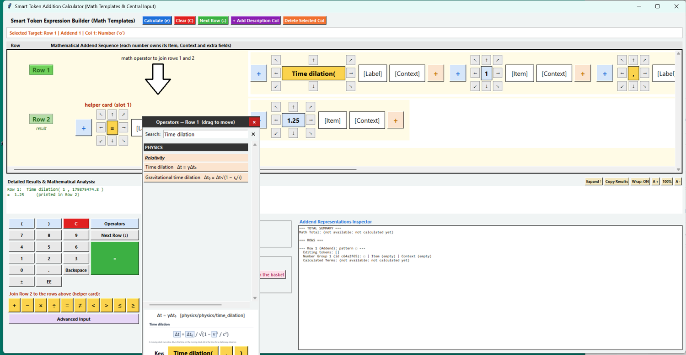

# Calculator

A desktop calculator written in Python (Tkinter) that works with **operators instead of a single
expression line**. You pick an operator from a library of 507 (arithmetic, algebra, calculus, linear
algebra, statistics, geometry, physics and more), fill in its square boxes, press `=`, and the answer
appears. Every operator comes with a picture of its formula.



*Time dilation(1, 179 875 474.8) = 1.25: one second on a clock moving at 60% of the speed of light is
1.25 seconds for a stationary observer.*

## What it can do

- **507 operators**, 446 of which calculate (the other 61 show their formula only, see below).
- **A picture of each formula** drawn with small square boxes for the inputs.
- **Rows and joins:** results from several rows can be combined with `+ − × ÷ = ≠ < > ≤ ≥`.
- **Operators inside operators:** put an operator into the box of another one.
- **Advanced Input** for things a number pad cannot type: lists, matrices, functions, sets and graphs.
- **Templates:** type your own math once, save it, and put it into a row whenever you want it.
- **Multi-row operators** (for example Stokes' theorem) that add the rows they need for you.
- **Safe function input:** typed functions such as `x**2 + 3*x` are checked against a small whitelist
  (no `eval` on raw text), so `__import__('os')` and similar are rejected.

### The operator library

| Area | Operators | Examples |
|---|---|---|
| Physics | 81 | motion, forces, energy, gravitation, electricity, **magnetism, fluid dynamics, quantum mechanics, optics, relativity** |
| Geometry | 33 | areas, volumes, distance, Heron's formula, law of sines and cosines |
| Algebra | 29 | quadratic formula, logs, roots, sequences and series, complex numbers, factor / expand / simplify |
| Real analysis | 29 | supremum, series tests, Riemann sums, norms, convergence |
| Statistics and probability | 29 | mean, variance, regression, distributions, z-score, confidence interval |
| Abstract algebra | 28 | groups, subgroups, cosets, kernels, rings and fields |
| Linear algebra | 26 | determinant, inverse, eigenvalues, LU / QR / SVD, dot and cross product |
| Topology | 26 | open and closed sets, closure, interior, boundary |
| Calculus | 24 | derivatives, integrals (single to triple), limits, gradient, curl, Taylor series |
| Optimization and numerical methods | 24 | Newton's method, bisection, Simpson's rule, linear programming, RK4 |
| Category theory and foundations | 23 | functions, injective / surjective, power sets, number systems |
| Trigonometry | 22 | sin, cos, tan and inverses, hyperbolic functions, identities |
| Graph theory and combinatorics | 21 | shortest path, max flow, chromatic number, Bell and Catalan numbers |
| Transforms and differential equations | 21 | Laplace, Fourier, DFT, first and second order ODEs |
| Logic and sets | 18 | and, or, implies, union, intersection, power set |
| Constants and relations | 16 | π, e, golden ratio, `=`, `≠`, `<`, `≥` |
| Differential geometry and tensors | 16 | metric tensor, Lie bracket, Gaussian curvature |
| Complex analysis | 15 | argument, Euler's formula, contour integrals, residues |
| Arithmetic | 14 | `+ − × ÷`, modulo, rounding, min, max |
| Discrete and number theory | 12 | factorial, combinations, gcd, lcm, primes, Fibonacci |

The full list, with each formula and whether it calculates, is in
[`operators_one_operator_per_file/INDEX.md`](operators_one_operator_per_file/INDEX.md).

## Requirements

- **Python 3** with **Tkinter**. It was developed and tested with Python 3.15 on Windows 11.
  Tkinter comes with the python.org installers for Windows and macOS. On Linux install it first, for
  example `sudo apt install python3-tk`.
- **Pillow** (shows the operator pictures). It is listed in `requirements.txt`.

## Download and run

1. Download the project from GitHub using **Code > Download ZIP** and extract it
   (or `git clone https://github.com/IWatchSheep/calculator.git`).
2. Open the folder in PyCharm (or any terminal) and open a terminal in it.
3. Install the one required package:

   ```
   python -m pip install -r requirements.txt
   ```

4. Start the calculator:

   ```
   python main.py
   ```

   On Windows you can also use `py main.py`.

## How to use it

**Example: time dilation.**

1. Click **Operators** on the keypad. A pop-up opens with the operator library, grouped by area.
2. Type `time dilation` in the **Search** box and click **Time dilation**. The pop-up shows its
   picture and the keys it needs, and Row 1 now reads `Time dilation( □ , □ )`.
3. Click the first square box and type `1` on the keypad. Click the second box and type `179875474.8`.
4. Press **`=`**. The result `1.25` appears in the results area and in Row 2.

**The pieces of the window**

| Part | What it does |
|---|---|
| Rows area (top) | Each row is a line of cards. Square boxes are the inputs. Click a box to select it. |
| Keypad (bottom left) | `0–9` and `.` type into the selected box. `±` flips the sign. `EE` starts a power of ten, so `1.5 EE ± 3` is `1.5e-3`. `Backspace` deletes. `Next Row (↓)` moves to the next row, adding one if needed. `=` calculates. `C` (or the toolbar's Clear (C)) clears everything and starts again. |
| Join keys | `+ − × ÷ = ≠ < > ≤ ≥` combine the result of a row with the rows above it. |
| Operators pop-up | Search and pick an operator. It shows the formula picture and the keys it uses. Drag it by its title bar. |
| Mathematical Templates | Type math, preview it, save it, and apply it to a row (see below). |
| Advanced Input | A pop-up for values that need more than a number (see below). |
| Results area | Shows what was calculated, for example `Row 1: Time dilation( 1 , 179875474.8 )` and `= 1.25`. |

**Nesting.** If Row 1 already holds an operator, picking another operator puts it into the
selected box, so the result of one feeds the next.

**Templates.** The *Mathematical Templates* panel keeps math you use often. There are four steps, and a
guide pop-up walks you through them the first time you start typing in the text box:

1. **Type your math** in the text box, for example `(? + 3) × 2` or `Time dilation(1, x)`.
2. Press **Preview Posted**. Your math is put into the target row, just like an operator from the Operators
   pop-up, so you can see it. Change the text and press it again to replace the preview.
3. Like it? Press **Save Template**. It is added to the list and saved in `saved_templates.json` next to
   `main.py`, so it is still there next time. The file is yours alone and is not part of the repository.
4. Whenever you want it: pick it in the list next to **Apply Template** and press **Apply Template**. It goes
   into the target row (inside the selected box if the row already has math). Fill the empty boxes and press `=`
   on the keypad.

**The guide pop-up** shows the four steps side by side. The step you are on is yellow, finished steps are green
with a tick, and under step 1 it tells you live whether your math is understood (`✓ Understood: (□ + 3) × 2
(1 empty box)`), still unfinished (`… keep typing`) or wrong (`✗ There is no operator called 'foo'`). Tick
*Don't show this again* to stop it opening; the **?** button beside Apply Template opens it any time. The small
`=` between the text box and Preview Posted is only a sign that the math in the box is what gets previewed.

What you can type:

| You type | Meaning |
|---|---|
| `3`, `2.5`, `.5`, `1.5e-3` | numbers |
| `□`, `?`, or a bare letter such as `x` | an empty box to fill in later (each one is its own box) |
| `+ − × ÷ ^ %` (or `* / -`) | the arithmetic operators; `^` binds tightest, then `× ÷ %`, then `+ −` |
| `( ... )` | grouping |
| `sqrt(16)`, `Square root(16)`, `sin(pi / 2)` | any operator in the library, by name or short name (`sqrt`, `sin`, `ln`, `abs`, `gcd`, ...), with its inputs in brackets |
| `Time dilation(1, □)` | operators with several inputs: separate them with commas |
| `pi`, `e` | the constants |

A mistake gives a plain message in the results area, for example `Time dilation needs 2 input(s) but was
given 1.` and nothing is saved.

**Advanced Input** lets a box take a list (`1, 2, 3`), a matrix (`1 2; 3 4`), a function of x
(`x**2 + 3*x`), a yes/no test (`x > 2`), a set, a list of edges, a graph (`A: B, C; B: C; C: A`), a
weighted graph, or a polynomial to factor. Pick the type, type the value, and it goes into the
selected box.

**Operators marked "reference"** (61 of them, such as `ring`, `manifold` or `open bracket`) show their
formula and picture but cannot calculate. Pressing `=` tells you so instead of failing.

**Angles are in radians**, and physics operators use standard constants by default (g = 9.81 m/s²,
c = 299 792 458 m/s, and so on). The constant is named in each operator's formula in `INDEX.md`.

## Using the operators from Python

Every operator is a plain Python file you can use without the window:

```python
from operators_one_operator_per_file import get

get("math/algebra/power").compute(2, 10)                      # 1024
get("physics/physics/lorentz_factor").compute(179875474.8)    # 1.25
get("math/linear_algebra/determinant").compute([[1, 2], [3, 4]])   # -2
```

Keys look like `math/<area>/<operator>`, `geometry/geometry/<operator>` and
`physics/physics/<operator>`. Each operator file defines `NAME`, `SYMBOL`, `FORMULA` and `compute(...)`.

## Project files

| Path | What it is |
|---|---|
| `main.py` | The calculator window |
| `gui_style.py` | Colours and button styles |
| `operator_links.py` | Connects each Operators pop-up button to its operator |
| `operators_one_operator_per_file/` | The 507 operators: one folder each with `<name>.py` (formula and `compute()`) and `<name>.jpg` (picture). `INDEX.md` lists them all |
| `operator_row_math/` | How each operator is laid out as cards in a row, the Advanced Input parser, and the multi-row operators |
| `tests/` | The automated test suite |
| `TESTING_GUIDE.md` | How to verify the calculator independently |
| `picture_of_gui/` | Screenshot and the original GUI mock-up |

## Testing

Run the automated test suite (standard library only; Pillow adds the picture check):

```
python tests/test_operators.py
```

It checks all 507 operators: 446 working operators against hand-calculated answers, plus structure,
error handling, input parsing, and the real calculator window for the newer physics operators
(magnetism, fluid dynamics, quantum mechanics, optics, relativity). The full run takes about a
minute because it drives the real window. See [`TESTING_GUIDE.md`](TESTING_GUIDE.md) for how to verify
the calculator independently, including a manual GUI checklist.

Numerical results are checked to about 1e-6, and only the newer physics operators are tested through
the window, so independent verification is still welcome.
